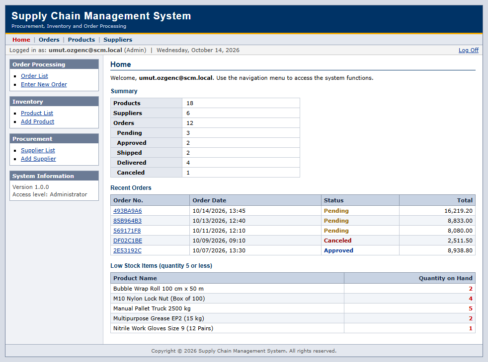
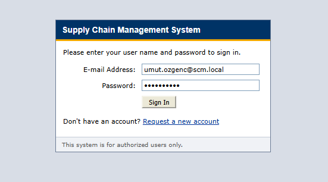
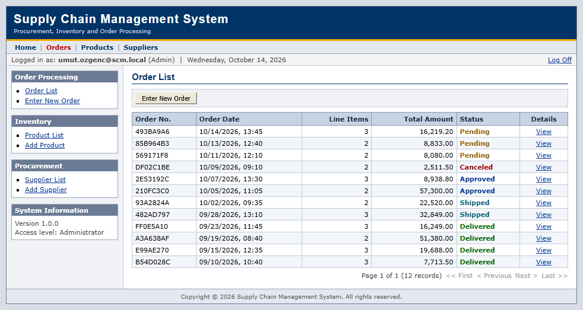
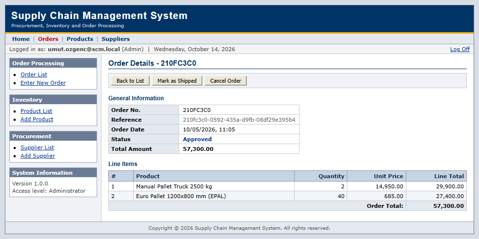
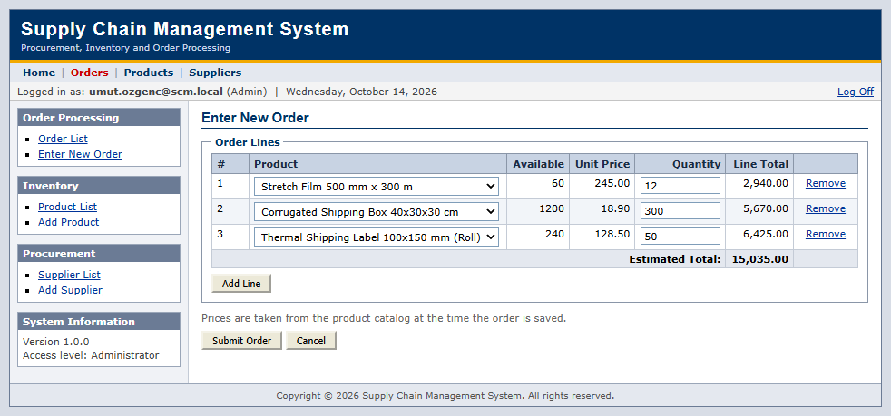
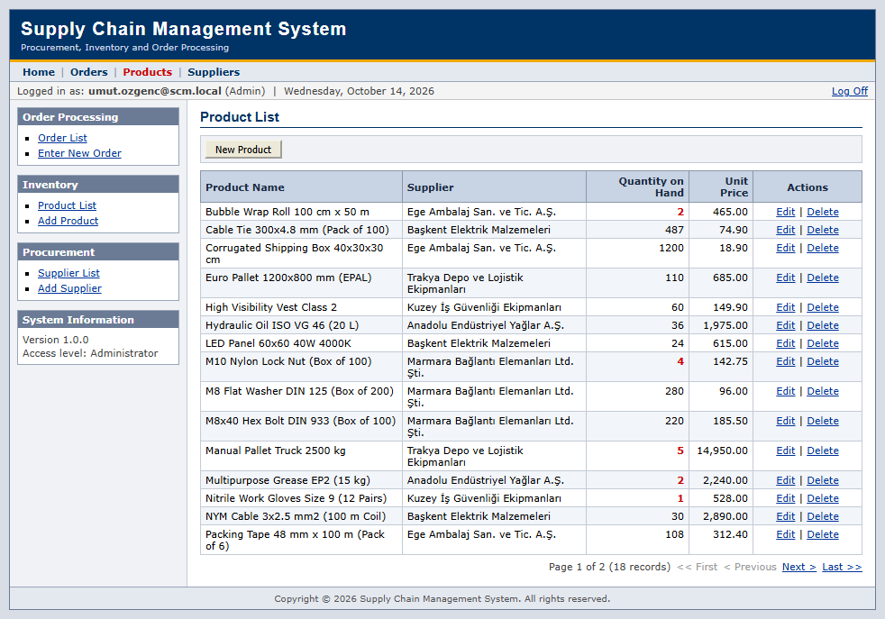
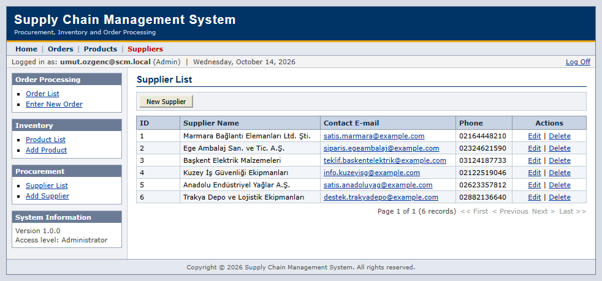
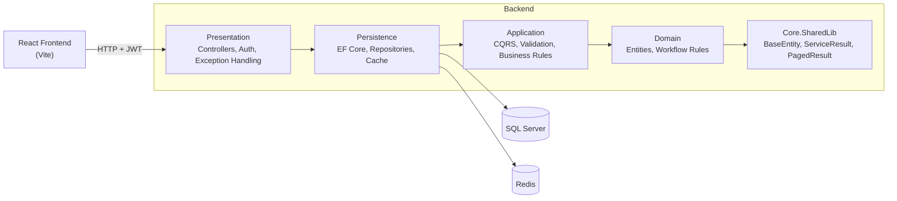
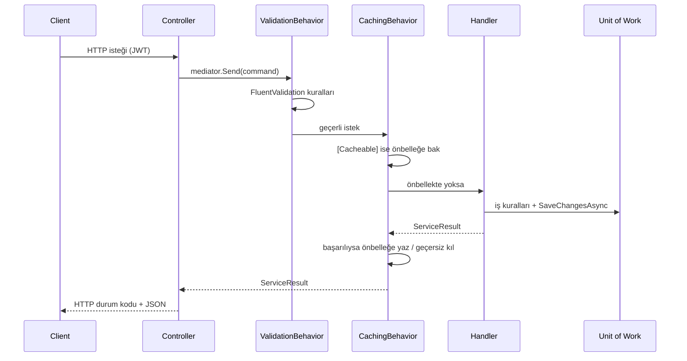
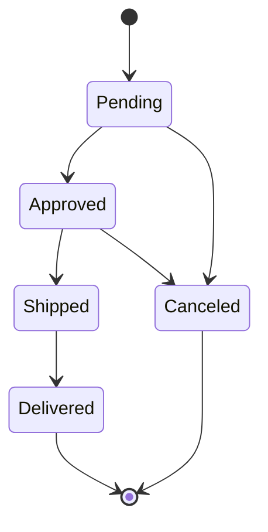

# Supply Chain Management System

Tedarikçi, ürün, stok ve sipariş süreçlerini yöneten; .NET 8 Web API ve React ile geliştirilmiş bir tedarik zinciri yönetim uygulaması. Backend Clean Architecture ve CQRS prensipleriyle katmanlara ayrılmıştır. Frontend ise klasik kurumsal intranet uygulamalarının sade arayüz anlayışıyla tasarlanmıştır.



## İçindekiler

- [Ekran Görüntüleri](#ekran-görüntüleri)
- [Kullanılan Teknolojiler](#kullanılan-teknolojiler)
- [Mimari](#mimari)
- [Backend Katmanları](#backend-katmanları)
- [İstek Yaşam Döngüsü](#istek-yaşam-döngüsü)
- [İş Kuralları](#iş-kuralları)
- [Kimlik Doğrulama ve Yetkilendirme](#kimlik-doğrulama-ve-yetkilendirme)
- [Önbellekleme](#önbellekleme)
- [Frontend Mimarisi](#frontend-mimarisi)
- [Testler](#testler)
- [Proje Yapısı](#proje-yapısı)

## Ekran Görüntüleri

### Giriş Ekranı



### Sipariş Listesi

Siparişler durumlarına göre renklendirilerek listelenir ve sayfalı olarak getirilir.



### Sipariş Detayı

Yönetici, siparişin mevcut durumuna göre yalnızca izin verilen geçişleri (onaylama, sevk etme, iptal) görür.



### Yeni Sipariş

Ürün seçildiğinde eldeki stok, birim fiyat ve satır toplamları anlık olarak hesaplanır.



### Ürün Listesi

Kritik stok seviyesindeki ürünler kırmızı ile vurgulanır.



### Tedarikçi Listesi



## Kullanılan Teknolojiler

### Backend

| Teknoloji | Nerede | Nasıl Kullanıldı |
|---|---|---|
| **.NET 8 / ASP.NET Core Web API** | `SupplyChainManagement.Presentation` | REST API, controller tabanlı endpoint'ler, primary constructor ile dependency injection |
| **Entity Framework Core 8 (SQL Server)** | `SupplyChainManagement.Persistence` | `AppDbContext`, Fluent API ile entity konfigürasyonları (`IEntityTypeConfiguration`), code-first migration'lar |
| **MediatR** | `SupplyChainManagement.Application` | Her use case bir command/query ve handler çifti olarak modellenir (CQRS). Çapraz kesen işler pipeline behavior olarak eklenir |
| **FluentValidation** | `Application/Features/*/Commands`, `Application/Behaviors` | Her request için ayrı validator; `ValidationBehavior` ile MediatR pipeline'ında handler'dan önce çalıştırılır |
| **AutoMapper** | `Application/Features/*/Profiles` | Entity ↔ DTO dönüşümleri, her feature için ayrı mapping profile |
| **JWT Bearer Authentication** | `Presentation/Security` | `JwtTokenService` ile token üretimi, `[Authorize]` ve rol tabanlı (`Admin`, `User`) yetkilendirme |
| **ASP.NET Core Identity PasswordHasher** | `Application/Features/Auth` | Kullanıcı şifrelerinin PBKDF2 ile hash'lenmesi ve doğrulanması |
| **Redis (StackExchange.Redis)** | `Persistence/Caching` | `IDistributedCache` üzerinden sorgu sonuçlarının önbelleklenmesi |
| **SQL Server 2022** | `docker-compose.yml` | Ana veritabanı, Docker container olarak |
| **Swagger / Swashbuckle** | `Presentation/Security/AuthenticationExtensions.cs` | API dokümantasyonu, JWT ile yetkilendirme desteği |
| **DotNetEnv** | `Presentation/Program.cs` | Gizli bilgilerin (`.env`) uygulama başlarken ortam değişkeni olarak yüklenmesi |
| **Docker Compose** | `docker-compose.yml` | SQL Server ve Redis servislerinin tanımı |

### Frontend

| Teknoloji | Nerede | Nasıl Kullanıldı |
|---|---|---|
| **React 18** | `frontend/SupplyChainManagement.Web/src` | Fonksiyon bileşenleri ve hook'lar ile sayfa ve bileşen yapısı |
| **TypeScript** | Tüm frontend kodu | API sözleşmesinin (`ServiceResult`, `PagedResult`, DTO'lar) tip güvenli şekilde modellenmesi |
| **React Router 6** | `src/App.tsx` | Sayfa yönlendirmeleri, korumalı rotalar (`RequireAuth`, `RequireAdmin`) |
| **Vite** | `vite.config.ts` | Geliştirme sunucusu, production build ve `/api` isteklerinin backend'e proxy edilmesi |
| **Saf CSS** | `src/styles.css` | Herhangi bir UI kütüphanesi kullanılmadan, tablo tabanlı klasik kurumsal arayüz |

### Test

| Teknoloji | Nerede | Nasıl Kullanıldı |
|---|---|---|
| **xUnit** | `SupplyChainManagement.Application.Tests` | Handler, validator, domain kuralı ve pipeline behavior testleri |
| **Moq** | `SupplyChainManagement.Application.Tests` | Repository, Unit of Work ve token servisinin taklit edilmesi |

## Mimari

Proje, bağımlılıkların her zaman içe (domain'e) doğru aktığı katmanlı bir yapıya sahiptir.



| Katman | Sorumluluk |
|---|---|
| **Core.SharedLib** | Tüm katmanların ortak kullandığı temel tipler: `BaseEntity<TId>`, `ServiceResult`, `PagedResult<T>` |
| **Domain** | `Order`, `OrderItem`, `Product`, `Supplier`, `User` entity'leri ve sipariş durum geçiş kuralları |
| **Application** | Use case'ler (command/query + handler), validator'lar, mapping profilleri, pipeline behavior'lar ve repository/servis arayüzleri |
| **Persistence** | EF Core ile veri erişimi, repository implementasyonları, Unit of Work, migration'lar ve dağıtık önbellek servisi |
| **Presentation** | HTTP katmanı: controller'lar, JWT yapılandırması, global exception handler, Swagger |

Application katmanı yalnızca arayüzleri (`IOrderRepository`, `IUnitOfWork`, `ICacheService`, `ITokenService`) tanır. Bu arayüzlerin somut implementasyonları dış katmanlarda yer alır ve dependency injection ile bağlanır.

## Backend Katmanları

### Feature Tabanlı Organizasyon

Application katmanı teknik türe göre değil, iş alanına göre klasörlenmiştir. Her feature kendi command, query, DTO ve mapping dosyalarını bir arada tutar:

```
Features/Orders/
├── Commands/
│   ├── Create/        CreateOrderCommand, Handler, Validator
│   ├── Update/        UpdateOrderCommand, Handler, Validator
│   ├── ChangeStatus/  ChangeOrderStatusCommand, Handler, Validator
│   └── Delete/        DeleteOrderCommand, Handler
├── Queries/
│   ├── GetAll/        GetAllOrdersQuery, Handler, Validator
│   └── GetById/       GetOrderByIdQuery, Handler
├── Dtos/
├── Profiles/
└── Rules/             OrderStockRules
```

### ServiceResult Deseni

Handler'lar iş kuralı ihlallerinde exception fırlatmak yerine `ServiceResult` döner. Sonuç, HTTP durum kodunu da taşır; böylece controller'lar tek satırla cevap üretir:

```csharp
public class OrdersController(IMediator mediator) : CustomBaseController
{
    [HttpPatch("{id:guid}/status")]
    [Authorize(Roles = nameof(UserRole.Admin))]
    public async Task<IActionResult> ChangeStatus(Guid id, [FromBody] ChangeOrderStatusCommand command, CancellationToken cancellationToken)
    {
        var result = await mediator.Send(command with { Id = id }, cancellationToken);
        return CreateActionResult(result);
    }
}
```

Tüm cevaplar aynı sözleşmeye sahiptir:

```json
{ "data": { ... }, "success": true, "message": "Order status changed to Approved." }
```

### Unit of Work

Repository'ler `SaveChanges` çağırmaz; değişiklikler handler'ın sonunda `IUnitOfWork.SaveChangesAsync` ile tek bir transaction içinde kaydedilir. Örneğin sipariş oluşturulurken stok düşümü ve sipariş kaydı birlikte kaydedilir ya da hiçbiri kaydedilmez.

### Global Exception Handling

`GlobalExceptionHandler` (`IExceptionHandler`) beklenmeyen hataları tek bir noktada ele alır:

| Exception | HTTP Durumu |
|---|---|
| `ValidationException` | 400 Bad Request ve hata listesi |
| `DbUpdateConcurrencyException` | 409 Conflict |
| Diğer tüm hatalar | 500 Internal Server Error (loglanır, detay istemciye gönderilmez) |

## İstek Yaşam Döngüsü

Bir isteğin API'ye girişinden veritabanına kadar izlediği yol:



## İş Kuralları

### Sipariş Durum Akışı

Durum geçişleri domain katmanında, `Order` entity'si içinde tanımlıdır. Geçersiz bir geçiş denemesi `409 Conflict` ile reddedilir.



- Sipariş kalemleri yalnızca `Pending` durumunda düzenlenebilir.
- Yalnızca `Pending` veya `Canceled` durumundaki siparişler silinebilir.

### Stok Yönetimi

`OrderStockRules` sipariş ile stok arasındaki ilişkiyi yönetir:

- Sipariş oluşturulurken her ürün için stok kontrol edilir ve rezerve edilir; yetersiz stokta işlem reddedilir.
- Aynı ürün siparişte birden fazla satırda gelirse tek kalemde birleştirilir.
- Sipariş düzenlendiğinde eski rezervasyon iade edilir, yeni miktar tekrar rezerve edilir.
- İptal edilen veya silinen bekleyen siparişlerin stokları geri eklenir.
- Kalem fiyatları istemciden alınmaz, her zaman ürün kataloğundaki güncel fiyattan hesaplanır.

### Eşzamanlılık Kontrolü

`Product` entity'si bir `RowVersion` (SQL Server `rowversion`) alanı taşır. Aynı ürüne aynı anda gelen siparişlerde EF Core optimistic concurrency kontrolü devreye girer; böylece stok hiçbir koşulda eksiye düşmez.

### Veri Bütünlüğü

- Bir siparişte kullanılmış ürün veya ürünleri siparişlerde yer alan tedarikçi silinemez (`409 Conflict`).
- Ürün eklenirken ve güncellenirken tedarikçinin varlığı kontrol edilir.
- Tüm liste endpoint'leri sayfalıdır (`pageNumber`, `pageSize` en fazla 100) ve `AsNoTracking` ile okunur.

## Kimlik Doğrulama ve Yetkilendirme

- `POST /api/auth/register` ve `POST /api/auth/login` endpoint'leri JWT access token döner.
- Token; kullanıcı kimliği, e-posta ve rol bilgisini claim olarak taşır, HMAC-SHA256 ile imzalanır.
- Tüm controller'lar varsayılan olarak `[Authorize]` ile korunur.

| İşlem | User | Admin |
|---|:---:|:---:|
| Ürün, tedarikçi ve siparişleri görüntüleme | ✓ | ✓ |
| Sipariş oluşturma ve bekleyen siparişi düzenleme | ✓ | ✓ |
| Ürün ve tedarikçi ekleme, düzenleme, silme | | ✓ |
| Sipariş durumunu değiştirme | | ✓ |

İlk yönetici hesabı, uygulama başlarken ortam değişkenlerindeki bilgilerle oluşturulur. 401 ve 403 cevapları da diğer tüm cevaplarla aynı `ServiceResult` formatında döner.

## Önbellekleme

Önbellekleme, handler'lara dokunmadan MediatR pipeline'ında attribute'lar ile yapılır:

```csharp
[Cacheable(CacheGroups.Products)]
public record GetAllProductsQuery(int PageNumber = 1, int PageSize = 10) : IRequest<ServiceResult<PagedResult<ProductDto>>>;

[InvalidatesCache(CacheGroups.Orders, CacheGroups.Products)]
public record CreateOrderCommand(List<OrderItemDto> OrderItems) : IRequest<ServiceResult<OrderDto>>;
```

- `[Cacheable]` ile işaretlenen sorguların başarılı sonuçları Redis'te 5 dakika tutulur. Önbellek anahtarı; grup, grup versiyonu, sorgu tipi ve sorgu parametrelerinden oluşur.
- `[InvalidatesCache]` ile işaretlenen komutlar başarılı olduğunda ilgili grupların versiyonunu değiştirir. Böylece anahtarları tek tek silmeye gerek kalmadan eski kayıtlar geçersiz olur. Stoğu etkileyen sipariş işlemleri ürün önbelleğini de geçersiz kılar.
- `DistributedCacheService`, Redis'e ulaşılamadığında hatayı loglar ve önbelleği 30 saniye boyunca devre dışı bırakır (circuit breaker). API bu sürede doğrudan veritabanından çalışmaya devam eder.

## Frontend Mimarisi

```
frontend/SupplyChainManagement.Web/src/
├── api/
│   ├── client.ts       fetch sarmalayıcı, token ekleme, ServiceResult çözümleme, ApiError
│   ├── endpoints.ts    kaynak bazlı API fonksiyonları (productsApi, ordersApi, ...)
│   └── types.ts        backend sözleşmesinin TypeScript karşılıkları
├── auth/
│   └── AuthContext.tsx oturum durumu, giriş/kayıt/çıkış, token süresi takibi
├── components/         Layout, Pager, hata ve bilgi kutuları, rota korumaları
├── pages/              her ekran için bir sayfa bileşeni
├── format.ts           para, tarih ve sipariş numarası biçimlendirme
├── useApi.ts           veri yükleme, hata ve yeniden yükleme için ortak hook
└── styles.css
```

- **API katmanı:** Tüm istekler `client.ts` üzerinden geçer. Bearer token otomatik eklenir, backend'in `ServiceResult` cevabı çözülür, hatalar `ApiError` olarak fırlatılır. 401 cevabında oturum kapatılır ve kullanıcı giriş ekranına yönlendirilir.
- **Oturum yönetimi:** `AuthContext`, token'ı ve rol bilgisini tutar; token süresi dolduğunda oturumu otomatik sonlandırır.
- **Yetkiye göre arayüz:** Yönetici olmayan kullanıcılar ürün ve tedarikçi düzenleme ekranlarını ve sipariş durum butonlarını görmez; yetki kontrolü backend'de ayrıca uygulanır.
- **Tasarım:** Herhangi bir UI kütüphanesi kullanılmamıştır. Arayüz; sabit genişlikli sayfa düzeni, kenarlıklı veri tabloları, `fieldset` ile gruplanmış formlar ve sade tipografi ile klasik kurumsal uygulama görünümünde tasarlanmıştır.

## Testler

`SupplyChainManagement.Application.Tests` projesi, iş mantığını veritabanından bağımsız olarak doğrular:

| Test Sınıfı | Kapsam |
|---|---|
| `OrderStockRulesTests` | Stok rezervasyonu, kalem birleştirme, yetersiz stok, stok iadesi |
| `OrderCommandHandlerTests` | Sipariş oluşturma, düzenleme, durum değişikliği ve silme senaryoları |
| `ProductCommandHandlerTests` | Tedarikçi kontrolü, siparişte kullanılan ürünün silinmesinin engellenmesi |
| `SupplierCommandHandlerTests` | Tedarikçi silme kuralları |
| `AuthCommandHandlerTests` | Kayıt, giriş, şifre hash'leme ve şifre kuralları |
| `OrderTests` | Sipariş durum geçiş matrisi |
| `ValidatorTests` | Request doğrulama kuralları |
| `ValidationBehaviorTests` | Doğrulama pipeline'ı |
| `CachingBehaviorTests` | Önbelleğe yazma, önbellekten okuma ve geçersiz kılma |

## Proje Yapısı

```
SupplyChainManagement/
├── Core.SharedLib/                          ortak tipler
├── SupplyChainManagement.Domain/            entity'ler ve domain kuralları
├── SupplyChainManagement.Application/       CQRS, validation, iş kuralları
├── SupplyChainManagement.Persistence/       EF Core, repository'ler, cache, migration'lar
├── SupplyChainManagement.Presentation/      Web API, JWT, exception handling
├── SupplyChainManagement.Application.Tests/ unit testler
├── frontend/
│   └── SupplyChainManagement.Web/           React + TypeScript arayüz
├── docs/screenshots/                        ekran görüntüleri
├── docker-compose.yml                       SQL Server ve Redis
└── .env.example                             ortam değişkenleri şablonu
```
